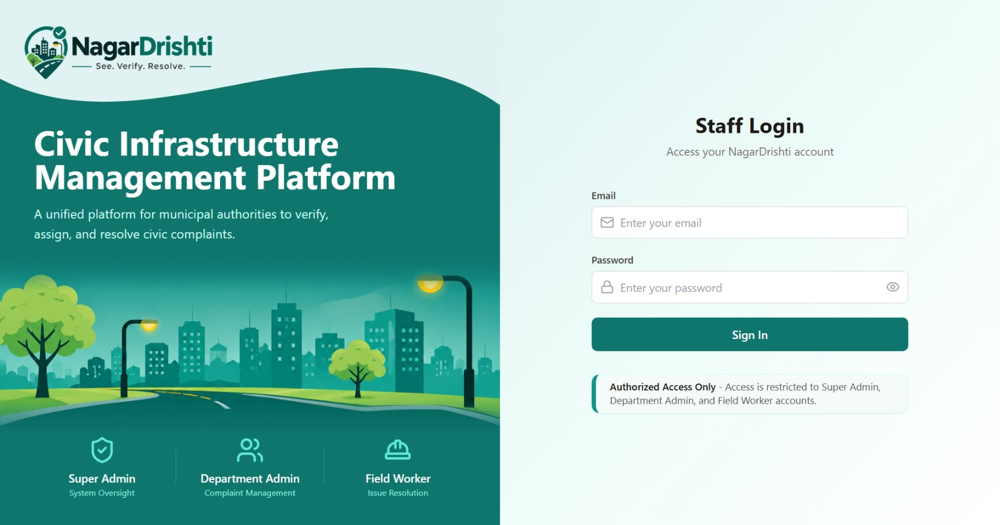
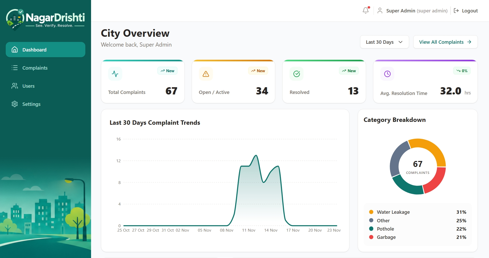
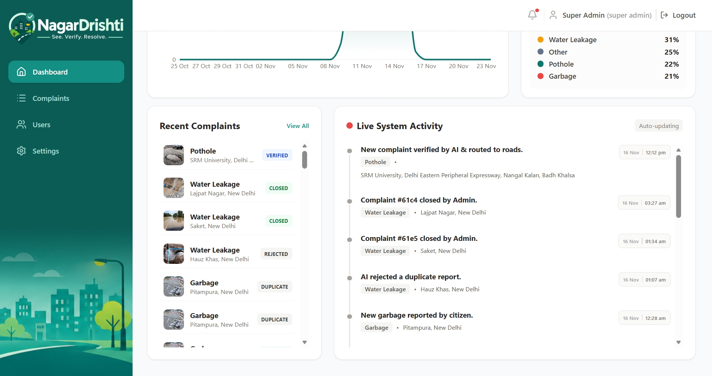
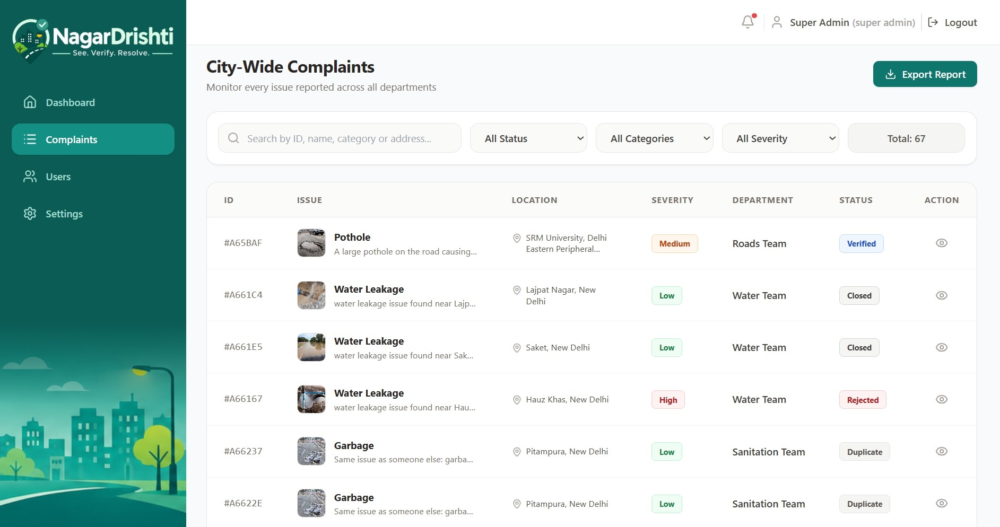
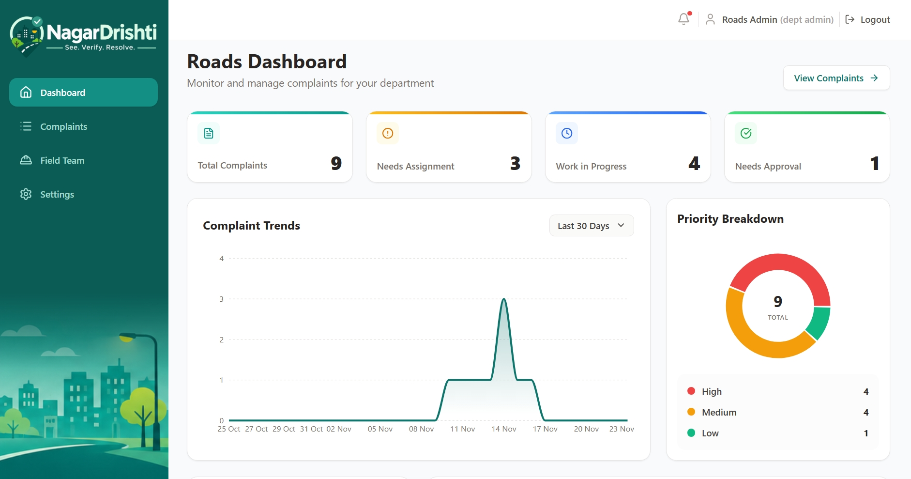
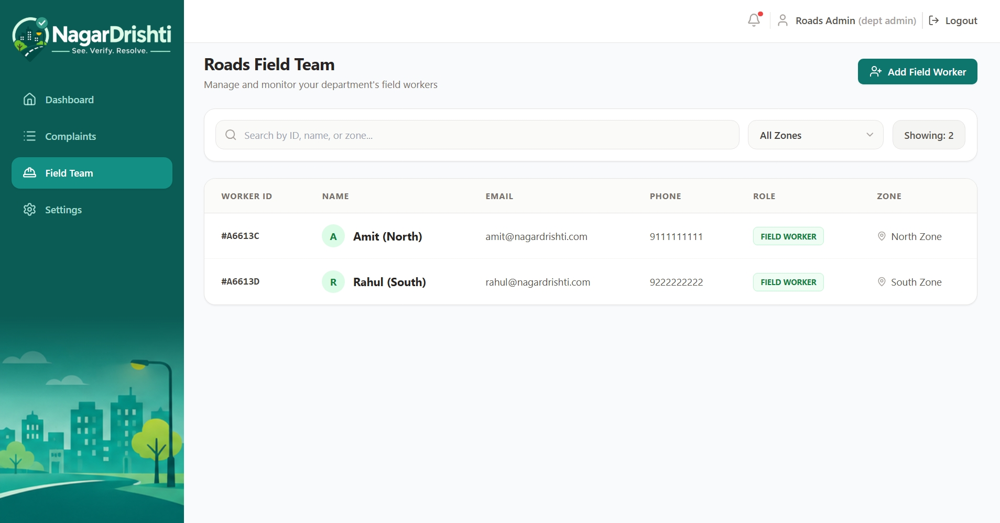
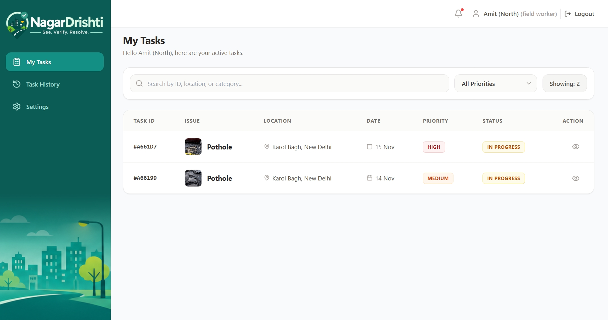

# 🏙️ NagarDrishti - Frontend

A modern, responsive, and role-based web application for municipal authorities to monitor, manage, and resolve civic infrastructure complaints.


---

## 📖 Overview

**NagarDrishti** is a civic-tech platform designed to bridge the gap between citizens and city administrators.

This frontend repository contains the dashboard for three distinct user roles:

1. **👑 Super Admin** — System-wide oversight, analytics, and user management.
2. **🏢 Department Admin** — Department-specific complaint management and field team assignment.
3. **👷 Field Worker** — Task execution, on-ground image verification, and resolution tracking.

The UI features a custom **"Municipal Teal & Stone"** theme, designed to look professional, trustworthy, and easy to navigate for government officials.

## ✨ Key Features

### 👑 Super Admin
- **City Overview Dashboard:** Real-time KPIs, 7-day complaint trends (Area chart), and category breakdown (Donut chart).
- **City-Wide Complaints:** Advanced search and filters (Status, Category, Severity), Pagination, and Excel Export.
- **User Management:** Add new Admins/Workers, view role-based directories.
- **Analytics & Reports:** AI insights, Heatmap visualization, and date-range specific report generation.
- **Detailed Complaint Modal:** 3-column view with AI analysis, Timeline, Before/After images, and Duplicate tracking.

### 🏢 Department Admin
- **Department Dashboard:** Track "Needs Assignment", "Work in Progress", and "Needs Approval" counts.
- **Complaint Management:** View department-specific complaints and assign them to field workers via a tabbed modal.
- **Field Team:** Monitor workers assigned to their specific department.

### 👷 Field Worker
- **My Tasks:** View assigned tasks, upload a "Before" image to start work, and upload an "After" image + work note to mark as resolved.
- **Task History:** Review past resolved/closed tasks with visual proof (Before & After).
- **Settings:** Universal settings page to update profile and change passwords.

## 🛠️ Tech Stack

| Technology | Purpose |
|---|---|
| **React 18** | Frontend framework |
| **Vite** | Development and build tool |
| **Tailwind CSS** | Styling and responsive UI |
| **React Router DOM** | Routing and protected role-based routes |
| **Recharts** | Data visualization and charts |
| **Lucide React** | UI icons |
| **SheetJS (xlsx)** | Excel export |
| **Axios** | HTTP requests and API communication |


## 🚀 Getting Started

### Prerequisites

Make sure you have **Node.js** installed on your machine.

### Installation

#### 1. Clone the repository

```bash
git clone https://github.com/meenaljo2006/nagardrishti-frontend.git
cd nagardrishti-frontend
```

#### 2. Install dependencies

```bash
npm install
```

#### 3. Run the development server

```bash
npm run dev
```

The application will be available at:

```text
http://localhost:5173
```

## 📂 Folder Structure

```text
src/
├── assets/          # Images, logos, and illustrations
├── components/      # Reusable UI components
│   ├── Sidebar
│   ├── DashboardLayout
│   └── ProtectedRoute
├── context/         # React Context
│   └── AuthContext
├── pages/           # Role-specific pages
│   ├── Super Admin
│   ├── Department Admin
│   └── Field Worker
├── services/        # Axios API configuration
├── App.jsx          # Main routing configuration
├── main.jsx         # React entry point
└── index.css        # Global Tailwind CSS and custom styles
```


## 🔐 Role-Based Access

NagarDrishti uses **role-based protected routes** to ensure that users can access only the functionality relevant to their role.

| Role | Main Responsibilities |
|---|---|
| 👑 **Super Admin** | City-wide monitoring, analytics, reports, and user management |
| 🏢 **Department Admin** | Department complaints and field-worker assignment |
| 👷 **Field Worker** | Assigned tasks, on-ground verification, and resolution |

## 📸 Screenshots

Here is a glimpse of the NagarDrishti platform in action:

### 1. Staff Login


### 2. Super Admin Dashboard
<p align="center">
  
  
</p>

### 3. City-Wide Complaints (Super Admin)


### 4. Department Admin Dashboard


### 5. Field Team Management


### 6. Field Worker Tasks


---
## 🔗 Backend Repository

This frontend is designed to work seamlessly with the NagarDrishti backend.

**Backend Repository:**  
https://github.com/meenaljo2006/NagarDrishti

**NagarDrishti — See. Verify. Resolve.**
